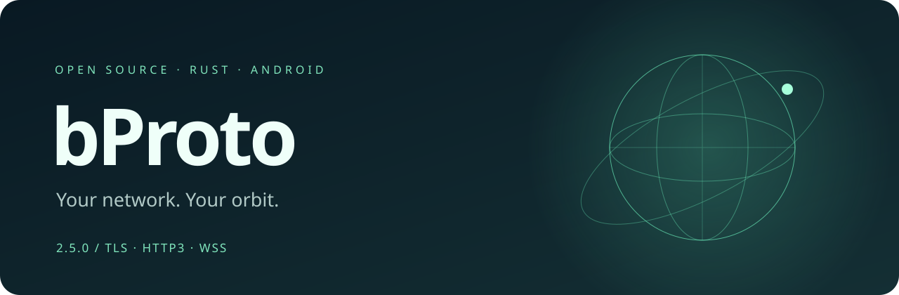

<p align="center">
  
</p>

<p align="center">
  <a href="https://github.com/dr-lexus-dr/bProto/actions/workflows/build.yml"></a>
  <a href="https://github.com/dr-lexus-dr/bProto/releases/tag/v2.5.0"></a>
  <a href="LICENSE"></a>
  
</p>

<p align="center">
  <b>Собственная сеть. Своя орбита.</b><br />
  Rust VPN · Android globe client · Linux server · bUI control panel
</p>

<p align="center">
  <a href="#quick-install">Установка / Install</a> ·
  <a href="https://github.com/dr-lexus-dr/bProto/releases/tag/v2.5.0">Загрузки / Downloads</a> ·
  <a href="docs/releases/2.5.0.md">Что нового / Release notes</a> ·
  <a href="docs/PLAN-2.5.md">Статус разработки / Roadmap</a>
</p>

**Русский.** bProto — VPN на Rust с собственным протоколом, Linux-сервером,
Android-клиентом с глобусом и веб-панелью. Версия 2.5.0 добавляет экспериментальные
TLS, HTTP/3 и WSS-транспорты, обязательный ECH на QUIC-клиенте и mTLS-агент
применения конфигураций. Эти компоненты требуют отдельной настройки.

**English.** bProto combines a custom Rust VPN protocol, a Linux server,
an Android globe client and a web control panel. Version 2.5.0 adds experimental
TLS, HTTP/3 and WSS carriers, required ECH on the QUIC client and an mTLS
configuration agent. These components require explicit deployment configuration.

> **Статус / Status:** 2.5.0 — выпуск с экспериментальными транспортами.
> Полный исследовательский план ещё не завершён. Обход РКН и белых списков
> не гарантируется; Android APK имеет debug-подпись.
>
> **2.5.0 ships experimental carriers.** The full research roadmap remains open.
> No guaranteed censorship/allowlist bypass. The Android APK is debug-signed.

## 2.5.0 — выберите свой транспорт / Choose your transport

| Возможность / Capability | Реализация / Implementation | Граница проверки / Validation boundary |
| --- | --- | --- |
| Native UDP | Rust client/server, Android JNI | Native tests; isolated kernel-TUN lab |
| TLS 1.3 | Python bridge + Android socket carrier | Native handshake; certificate rejection |
| QUIC v1 / HTTP3 | aioquic server + Rust h3/quinn + Android JNI | Independent Rust/Python exchange and native bProto handshake |
| WSS | Python + Android OkHttp | Native handshake; JVM TLS/WebSocket round-trip |
| Required ECH | Rust/Android QUIC client | Emission, hidden inner hostname, safe rejection; accepting-server e2e pending |
| Panel + agent | Export; TLS Apply/Health/Rollback over mTLS | Agent transactions/mTLS tests; production deployment e2e pending |

### Настроить транспорт / Configure a carrier

- [TLS — RU/EN](tools/tls-bridge/README.md)
- [QUIC / HTTP3 — English](tools/quic-bridge/README.md) · [Русский](tools/quic-bridge/README.ru.md)
- [WSS / owned reverse proxy — English](tools/fronting/README.md) · [Русский](tools/fronting/README.ru.md)
- [ECH — English](tools/ech/README.md) · [Русский](tools/ech/README.ru.md)
- [Configuration agent — English](tools/config-agent/README.md) · [Русский](tools/config-agent/README.ru.md)
- [Connection lab](tools/connection-lab/README.md) · [Audit](docs/AUDIT.md)

**RU.** В Settings панели выберите TLS, WSS или QUIC, задайте свой домен и
экспортируйте Android-ключ из существующих учётных данных bProto. Серверный мост
запускается отдельно. Apply относится к настроенному TLS-сервису. Перед полным
туннелем Linux закрепите маршрут к внешнему адресу моста. Профили и токены секретны.

**EN.** In panel Settings, select TLS, WSS or QUIC and export an Android key
using existing native credentials. Deploy the server carrier separately.
Apply targets the configured TLS service. Pin the outer carrier route before
Linux full-tunnel use. Profiles and bearer tokens contain secrets.

**Что ещё открыто / Still open:** accepting-server ECH, DNS ECH discovery/rotation,
verified browser fingerprints, Android device/VpnService tests for new carriers,
live CDN/target-network validation and agent crash recovery. Local test counts
do not certify DPI indistinguishability. See the release notes for exact scope.

## Содержание / Contents

Каждый раздел содержит русский и английский текст; команды общие, если не указано иное.
Each section includes Russian and English explanations; commands are shared unless stated otherwise.

| Начало / Getting started | Эксплуатация / Operations | Устройство / Internals |
| --- | --- | --- |
| [Быстрая установка / Quick install](#quick-install) | [Служба / Service](#service) | [Архитектура / Architecture](#architecture) |
| [Доверие скрипту / Script trust](#script-trust) | [NAT и адрес / NAT and endpoint](#nat) | [Протокол / Protocol](#protocol) |
| [Требования / Requirements](#requirements) | [Firewall](#firewall) | [Возможности / Capabilities](#capabilities) |
| [Параметры / Options](#bootstrap-options) | [Конфигурация / Configuration](#server-config) | [Безопасность / Security](#security) |
| [Скачивание / Download only](#download-only) | [Ключи / Keys](#keys) | [Разработка / Development](#development) |
| [Файлы / Files](#files) | [Обновление / Upgrade](#upgrade) | [Участие / Contributing](#contributing) |

**Клиенты / Clients:** [Linux](#linux-client) · [Android](#android) ·
[Профили / Profiles](#profiles) · [Автовыбор / Automatic selection](#automatic).

**Панель / Panel:** [Установка / Installation](#panel-install) · [HTTPS](#https) ·
[Первый вход / First login](#panel-first-login) · [Синхронизация ключей / Key sync](#key-sync) ·
[Подписки / Subscriptions](#subscriptions).

**Маршрутизация / Routing:** [Правила / Rules](#routing) · [Split tunnel](#split-tunnel) ·
[DNS и IPv6](#dns-ipv6) · [Приватность / Privacy](#privacy).

**Обслуживание / Maintenance:** [Резервные копии / Backups](#backups) · [Откат / Rollback](#rollback) ·
[Удаление / Removal](#uninstall) · [Диагностика / Troubleshooting](#troubleshooting) ·
[FAQ](#faq) · [Поддержка / Support](#support) · [Релизы / Releases](#releases).

<a id="quick-install"></a>
## Быстрая установка на VPS / Quick VPS installation

**RU.** Для готового пакета нужен x86_64 VPS с Ubuntu 24.04+ или Debian 13+,
systemd и доступным TUN. Откройте root-оболочку: `sudo -i`. Затем выполните:

**EN.** The prebuilt package requires an x86_64 VPS running Ubuntu 24.04+ or
Debian 13+, with systemd and TUN available. Enter a root shell using `sudo -i`, then run:

```bash
bash <(curl -fsSL https://raw.githubusercontent.com/dr-lexus-dr/bProto/main/bootstrap.sh)
```

**RU.** Команда скачивает бинарники **v2.5.0**, проверяет контрольную сумму,
размещает текущие скрипты проекта в `/opt/bproto`, устанавливает сервер и CLI,
создаёт ключи и службу. Rust не нужен. Порты firewall скрипт не открывает:
после завершения проверьте UDP 443, `nat_interface` и публичный адрес клиента.
Служба должна перейти в `active`; ошибка запуска возвращает ненулевой код.

**EN.** The command downloads **v2.5.0** binaries, verifies their checksum,
places current project scripts in `/opt/bproto`, installs the server and CLI,
and creates keys and a service. Rust is not required. The script does not open
firewall ports: check UDP 443, `nat_interface` and the client’s public endpoint
after installation. The service should become `active`; startup failure returns
an error status.

```bash
systemctl status bproto-server --no-pager
journalctl -u bproto-server -n 50 --no-pager
```

<a id="script-trust"></a>
## Что выполняет curl-команда / Understanding the curl command

**RU.** `bash <(...)` — синтаксис Bash, не обычного `sh`. `curl -f` возвращает
ошибку при HTTP 404/500, `-sS` скрывает прогресс, но показывает ошибки, `-L`
следует перенаправлениям. Не используйте `curl -k`: проверка HTTPS должна оставаться
включённой. Загружаемый скрипт с ветки `main` может меняться. Проверка SHA256
архива защищает от повреждения скачивания, но не является независимой подписью
издателя: сам манифест приходит из того же GitHub-релиза.

**EN.** `bash <(...)` is Bash syntax, not portable `sh` syntax. `curl -f` fails
on HTTP 404/500, `-sS` hides progress while keeping errors visible, and `-L`
follows redirects. Do not use `curl -k`; retain HTTPS verification. The script
on `main` can change. Archive SHA256 verification detects download corruption,
but is not an independent publisher signature: the manifest comes from the same release.

**RU.** Для просмотра до запуска скачайте файл отдельно. Это также удобнее,
если `sudo bash /dev/fd/...` не видит файловый дескриптор process substitution.
**EN.** Download first if you want to inspect the script, or if `sudo bash
/dev/fd/...` cannot access a process-substitution descriptor.

```bash
curl --proto '=https' --tlsv1.2 -fsSL \
  https://raw.githubusercontent.com/dr-lexus-dr/bProto/main/bootstrap.sh \
  -o bootstrap.sh
less bootstrap.sh
bash -n bootstrap.sh
bash bootstrap.sh --dry-run
sudo bash bootstrap.sh
```

<a id="requirements"></a>
## Требования / Requirements

| Компонент / Component | Требования / Requirements |
| --- | --- |
| Готовый Linux-пакет / Prebuilt Linux package | x86_64, glibc ≥ 2.39; Ubuntu 24.04+ / Debian 13+ |
| Сервер / Server | Linux TUN, systemd для установщика / for installer; `ip`, `nft`, root during installation |
| Сборка Rust / Rust build | Rust ≥ 1.88, C compiler/linker, Cargo lockfiles |
| Панель / Panel | Docker Engine + Compose v2; DNS hostname; TCP 80/443 |
| Панель из исходников / Panel from source | Rust + Node 20+; pnpm 9.15.9 |
| Android | Android 8 / API 26 or newer; arm64-v8a, armeabi-v7a, x86_64 |
| Сборка Android / Android build | JDK 17, Gradle 8.11.1, SDK 35, NDK 27.2.12479018, cargo-ndk 3.5.4 |

**RU.** Виртуальный сервер должен разрешать `/dev/net/tun` и сетевые capabilities.
Обычный контейнер без этих прав не подходит для серверного datapath. Ubuntu 22.04
может использоваться для самостоятельной совместимой сборки, но bootstrap
откажется устанавливать на него бинарник, собранный с более новой glibc.
Alpine/musl и готовый Linux ARM64-пакет текущим bootstrap не поддерживаются.

**EN.** Your VPS must expose `/dev/net/tun` and permit network capabilities.
An ordinary container without them cannot run the server datapath. Ubuntu 22.04
can be used for a compatible source build, but bootstrap rejects the prebuilt
binary on its older glibc. Alpine/musl and prebuilt Linux ARM64 installation
are not supported by the current bootstrap.

```bash
uname -m
getconf GNU_LIBC_VERSION
test -c /dev/net/tun && echo 'TUN available'
```

<a id="bootstrap-options"></a>
## Параметры bootstrap / Bootstrap options

| Флаг / Flag | Значение по умолчанию / Default | Назначение / Purpose |
| --- | --- | --- |
| `--release TAG` | `v2.5.0` | Версия бинарников / Binary release tag |
| `--directory PATH` | `/opt/bproto` | Постоянный checkout / Persistent checkout |
| `--target TARGET` | `all` | `server`, `client`, `all` |
| `--port PORT` | `443` | UDP-порт **нового** конфига / UDP port for a **new** config |
| `--no-start` | off | Не запускать службу / Do not start service |
| `--skip-deps` | off | Не выполнять apt-get / Do not run apt-get |
| `--download-only DIR` | off | Только проверенное скачивание / Verified download only |
| `--dry-run` | off | План без сети и изменений / Plan without network or host changes |
| `--help` | — | Справка / Help |

```bash
bash bootstrap.sh --dry-run --target server --port 8443
sudo bash bootstrap.sh --target all --port 8443 --no-start
sudo bash bootstrap.sh --skip-deps --directory /opt/bproto
```

**RU.** `all` означает сервер + Linux CLI, не панель. Панель устанавливается
отдельно после Docker и DNS. `--port` не меняет уже существующий `server.toml`:
измените конфигурацию вручную и перезапустите службу. `--release` выбирает
бинарники опубликованного релиза; установочные скрипты берутся из `main`.

**EN.** `all` means server + Linux CLI, not the panel. Install the panel
separately after setting up Docker and DNS. `--port` does not rewrite an existing
`server.toml`; edit it and restart the service. `--release` selects published
binaries, while installation scripts come from `main`.

<a id="download-only"></a>
## Только скачивание и ручная установка / Download-only and manual installation

**RU.** Этот режим не требует root, не запускает apt, не создаёт службу и не
меняет маршруты. Укажите ещё не существующий каталог. Он скачивает Linux-архив,
проверяет SHA256 по манифесту релиза и проверяет наличие серверного и клиентского
бинарников в архиве.

**EN.** This mode needs no root, does not run apt, and does not create services
or change routes. Choose a directory that does not exist yet. It downloads the
Linux archive, checks its release-manifest SHA256 and confirms that server and
client binaries are present.

```bash
bash bootstrap.sh --download-only "$PWD/bproto-download"
cd bproto-download
sha256sum --check bproto-linux-x86_64.tar.gz.sha256
tar -tzf bproto-linux-x86_64.tar.gz
```

**RU.** Для ручного развёртывания разместите `dist/` из архива в checkout проекта
и вызовите `sudo ./install.sh all --no-build`. Один архив бинарников не содержит
полного окружения установки: нужны скрипт и systemd unit из исходников. Для
офлайн-сервера заранее перенесите исходники, бинарники и системные зависимости.

**EN.** For manual deployment, extract `dist/` into the source checkout and run
`sudo ./install.sh all --no-build`. A binary archive alone is not the complete
installation environment: use the installer and systemd unit from the source
checkout. For an offline host, transfer sources, binaries and OS dependencies
in advance.

<a id="files"></a>
## Что появляется на сервере / Installed files

| Путь / Path | Содержимое / Contents |
| --- | --- |
| `/opt/bproto` | Checkout текущих скриптов / Current installation source checkout |
| `/opt/bproto/dist/bin` | Проверенные скачанные бинарники / Verified downloaded binaries |
| `/usr/local/bin/vpn-server` | Исполняемый файл сервера / Server executable |
| `/usr/local/bin/bproto` | Linux CLI |
| `/etc/bproto/server.toml` | Ключи и настройки сервера / Server settings and keys |
| `/etc/bproto/user1.client.toml` | Начальный клиент / Initial client configuration |
| `/etc/systemd/system/bproto-server.service` | Служба / Service unit |
| `/etc/sysctl.d/99-bproto.conf` | IPv4 forwarding |
| `/opt/bproto/panel/.env` | Домен и секреты панели / Panel domain and secrets |

**RU.** Каталог `/etc/bproto` имеет `0750`, владелец `root`, группа `bproto`.
Конфиг сервера — `root:bproto`, `0640`: сервис может его прочитать, обычные
пользователи — нет. Клиентский файл остаётся `0600`. Не выдавайте группе `bproto`
чужие учётные записи. Данные Docker-панели находятся в named volumes; они не
исчезают при обычном `docker compose down`, но удаляются с `down -v`.

**EN.** `/etc/bproto` is `0750`, owned by `root:bproto`. The server configuration
is `0640`, owned by `root:bproto`, so the service can read it but ordinary users
cannot. The client file remains `0600`. Do not add unrelated accounts to the
`bproto` group. Docker panel data lives in named volumes: ordinary
`docker compose down` preserves them; `down -v` removes them.

<a id="service"></a>
## Служба systemd / systemd service

```bash
sudo systemctl status bproto-server --no-pager
sudo systemctl restart bproto-server
sudo systemctl stop bproto-server
sudo systemctl start bproto-server
sudo systemctl enable bproto-server
sudo journalctl -u bproto-server -n 100 --no-pager
```

**RU.** Сервер запускается от системного пользователя `bproto`. `CAP_NET_ADMIN`
нужен для TUN/NAT, `CAP_NET_BIND_SERVICE` — для портов ниже 1024, включая UDP 443.
Служба не запускается целиком от root. Установщик добавляет `--datapath`: без него
сервер отвечает на рукопожатия, но не пересылает IP-пакеты. `active` доказывает
только работу процесса; интернет через VPN проверяйте отдельно с клиента.

**EN.** The service runs as the system account `bproto`. `CAP_NET_ADMIN` permits
TUN/NAT; `CAP_NET_BIND_SERVICE` permits low ports including UDP 443. The process
does not run entirely as root. The installer sets `--datapath`: without it the
server answers handshakes but drops IP packets. An `active` service proves only
that the process is running; test Internet forwarding from a client separately.

**RU.** Проверка файла до перезапуска / **EN.** Validate before restarting:

```bash
sudo /usr/local/bin/vpn-server --check-config --config /etc/bproto/server.toml
sudo systemctl cat bproto-server
```

<a id="nat"></a>
## Публичный адрес, NAT и forwarding / Public endpoint, NAT and forwarding

**RU.** Автоматическое определение IP часто возвращает **локальный** адрес VPS
за NAT. В клиентской конфигурации должен стоять адрес, доступный пользователю
из интернета: публичный IP и внешний UDP-порт. Проверьте его в панели провайдера.
Если VPS находится за NAT, настройте перенаправление UDP снаружи на порт сервера.
Имя интерфейса для исходящего трафика не всегда `eth0` — встречаются `ens3`, `enp1s0`.

**EN.** Automatic address detection can return a **private** address on a
NAT-backed VPS. The client needs an endpoint reachable from its network:
public IP and external UDP port. Check your provider’s console. If the VPS is
behind NAT, forward the external UDP port to the server. The outbound interface
is not always `eth0`; `ens3` and `enp1s0` are common.

```bash
ip route get 1.1.1.1
sysctl net.ipv4.ip_forward
sudo nft list ruleset
sudoedit /etc/bproto/server.toml
```

**RU.** `nat_interface` должен совпадать с `dev` из маршрута наружу.
`net.ipv4.ip_forward` должен быть `1`. Не заменяйте весь действующий ruleset
командами из случайной инструкции: это может оборвать SSH или другие сервисы.
**EN.** Set `nat_interface` to the outbound route’s `dev` value. IPv4 forwarding
must be `1`. Do not replace the whole firewall ruleset with unrelated examples;
you could disconnect SSH or other services.

<a id="firewall"></a>
## Порты и firewall / Ports and firewall

| Порт / Port | Для чего / Purpose | Доступ / Exposure |
| --- | --- | --- |
| UDP 443, либо выбранный / or selected port | VPN transport | Клиентам / Client networks |
| TCP 80 | Caddy HTTP / ACME | Интернет при установке панели / Internet for panel setup |
| TCP 443 | HTTPS панели / Panel HTTPS | Пользователям панели / Panel users |
| TCP 8080 | Backend панели / Panel backend | Только Compose network / Compose network only |
| TCP 9100 | Административный endpoint сервера / Server administration | Loopback only |
| TCP 22, либо SSH-порт / or SSH port | SSH | По вашей политике / Your access policy |

**RU.** UDP 443 и TCP 443 — разные сокеты: VPN и HTTPS-панель могут использовать
один номер порта на одном VPS. Однако HTTP/3 Caddy или другой UDP-сервис может
занять UDP 443; проверяйте `ss`. Кроме firewall ОС часто есть отдельный security
group у провайдера. Разрешите SSH **до** включения нового firewall.

**EN.** UDP 443 and TCP 443 are different sockets: the tunnel and HTTPS panel
can share the port number. Caddy HTTP/3 or another UDP service can still occupy
UDP 443, so inspect listeners. Cloud-provider security groups are separate
from the host firewall. Allow SSH **before** enabling a new firewall.

```bash
sudo ss -lntup
# If UFW is already your chosen firewall:
sudo ufw allow 443/udp
sudo ufw allow 80/tcp
sudo ufw allow 443/tcp
sudo ufw status verbose
```

<a id="server-config"></a>
## Конфигурация сервера / Server configuration

**RU.** Редактируйте существующий файл через `sudoedit`, сохраняя ключи.
Ниже — схема, не готовый секретный конфиг: замените placeholders реальными
значениями. Для рабочего первого конфига используйте генерацию установщика.

**EN.** Edit the existing file with `sudoedit`, preserving keys. This is a
schema example, not a usable secret configuration. Replace placeholders with
real values, or let the installer generate the initial configuration.

```toml
listen_addr = "0.0.0.0:443"
tag_key = "<64 hex characters shared with the panel>"

[donor]
sni = "www.cloudflare.com"

[tun]
name = "bproto0"
address = "10.66.0.1"
netmask = "255.255.255.0"
mtu = 1280
nat_interface = "ens3"

[admin]
listen_addr = "127.0.0.1:9100"
token = "<64 hex characters>"

[[users]]
id = 1
psk = "<64 hex characters for this user>"
```

**RU.** `tag_key` общий для развёртывания, `psk` индивидуален. SNI в текущей
версии не делает UDP-трафик похожим на настоящий HTTPS. Смена ключей без
обновления клиентов разрывает совместимость. После изменений выполните
`--check-config`, затем перезапустите службу.

**EN.** `tag_key` is shared across the deployment; PSKs are individual. The SNI
field does not make current UDP traffic indistinguishable from HTTPS. Changing
keys without updating clients breaks compatibility. Run `--check-config`
after changes, then restart the service.

<a id="keys"></a>
## Ключи и первый клиент / Keys and the first client

**RU.** Начальный файл `/etc/bproto/user1.client.toml` уже содержит PSK и tag key.
Скопируйте его на Linux-клиент защищённым способом и исправьте публичный endpoint.
Не публикуйте файл в issue. Для Android обычно удобнее URI из панели. Если панель
ещё не установлена, URI для начального клиента можно создать из TOML:

**EN.** `/etc/bproto/user1.client.toml` already contains a PSK and tag key.
Transfer it securely to a Linux client and correct its public endpoint. Never
attach it to an issue. Android normally imports a URI from the panel. Before
installing a panel, you can convert the initial TOML file into a URI:

```bash
# Python 3.11+. Output is SECRET: do not record or publish it.
sudo python3 - <<'PYCODE'
import base64, json, tomllib
with open('/etc/bproto/user1.client.toml', 'rb') as file:
    config = tomllib.load(file)
body = dict(v=1, server=config['server'], uid=config['user_id'],
            sni=config['donor']['sni'], psk=config['psk'],
            tag_key=config['tag_key'], fp=config.get('fingerprint', 'chrome112'))
encoded = base64.urlsafe_b64encode(json.dumps(body).encode()).decode().rstrip('=')
print('bproto://import/' + encoded)
PYCODE
```

**RU.** До конвертации исправьте `server` на публичный IP:port. URI эквивалентен
секретному конфигу, а QR-код — визуальное представление этого же секрета.
**EN.** Correct `server` to the public IP:port before converting. The URI is
secret configuration material; its QR code contains the same secret.

<a id="linux-client"></a>
## Linux CLI / Linux client

**RU.** Серверный bootstrap с `--target all` ставит CLI на VPS для обслуживания;
для использования VPN установите CLI на отдельное Linux-устройство. Режим
`connect` проверяет рукопожатие, но не меняет маршруты. `up` создаёт TUN и
меняет default route, поэтому требует root. При удалённой проверке полный
туннель может изменить маршрут вашего SSH-соединения.

**EN.** Server bootstrap with `--target all` installs the CLI for maintenance;
install it on a separate Linux device to use the VPN. `connect` tests the
handshake without changing routes. `up` creates TUN and changes the default
route, requiring root. A full tunnel on a remote machine can change the route
used by your SSH session.

```bash
bproto --version
bproto import 'bproto://import/REPLACE_WITH_YOUR_KEY' --out client.toml
chmod 600 client.toml
bproto --config client.toml check
bproto --config client.toml connect --seconds 5
sudo bproto --config client.toml up
# Configure TUN without moving the default route:
sudo bproto --config client.toml up --no-default-route
```

**RU.** CLI не предоставляет Android package exclusions и не импортирует JSON
подписку как список серверов. DNS в Linux настраивает оператор. Подробности
отката маршрутов и DNS находятся в [INSTALL.md](docs/INSTALL.md).
**EN.** The CLI does not implement Android package exclusions or import a JSON
subscription as a server list. Linux DNS remains operator-managed. See
[INSTALL.md](docs/INSTALL.md) for route rollback and DNS details.

<a id="android"></a>
## Android: установка и глобус / Android installation and globe

**RU.** Скачайте APK только из [релиза проекта](https://github.com/dr-lexus-dr/bProto/releases).
Устройство должно разрешать установку из выбранного источника. В релизе 1.0.0
APK подписан debug-ключом. Если Android сообщает о несовместимой подписи при
обновлении, потребуется удаление старого приложения; сначала сохраните свою
подписку, поскольку профили устройства будут удалены.

**EN.** Download the APK from the [project release](https://github.com/dr-lexus-dr/bProto/releases).
Allow installation from your selected source. Release 1.0.0 is debug-signed.
If an update fails because the signatures differ, uninstalling the old app may
be necessary. Keep your subscription before doing so; device profiles are removed.

1. **RU:** вставьте `bproto://import/...` или HTTPS-подписку. **EN:** paste a key URI or HTTPS subscription.
2. **RU:** импортируйте подписку и выберите сервер. **EN:** import the subscription and choose a server.
3. **RU:** нажмите глобус и разрешите создание VPN. **EN:** tap the globe and grant VPN consent.
4. **RU:** дождитесь подтверждения соединения. **EN:** wait for connected status.
5. **RU:** повторное нажатие отключает VPN. **EN:** tap again to disconnect.

**RU.** Рисунок глобуса — кнопка подключения, не карта реальных координат серверов.
Проверки сборки не заменяют испытания на вашем физическом устройстве.
**EN.** The globe is a connection control, not a map of verified server locations.
Build validation does not replace testing on your physical device.

<a id="profiles"></a>
## Профили Android / Android profiles

**RU.** Импортированные серверы сохраняются зашифрованными AES-GCM с ключом
Android Keystore. Секреты не записываются в обычные preferences и исключены из
backup storage. Выбор сервера и режим Automatic запоминаются отдельно без
сохранения URI в открытом виде. Кнопка сервера повторно открывает список.

**EN.** Imported servers are stored using AES-GCM with an Android Keystore key.
Secrets are not stored in ordinary preferences and are excluded from backup
storage. Selected server and Automatic mode are remembered separately without
storing a plaintext URI. The server button reopens the imported list.

**RU.** `Routing settings` меняет маршрутизацию выбранного профиля. `Reset to
full tunnel` возвращает маршрут по умолчанию. `Forget profiles` удаляет список
после подтверждения. Повторный импорт заменяет профили и локальные overrides:
сохраните нужные правила в панели, если они должны переживать обновление подписки.

**EN.** `Routing settings` changes the selected profile’s routing policy.
`Reset to full tunnel` restores defaults. `Forget profiles` removes the list
after confirmation. Reimporting replaces profiles and local overrides; store
rules in the panel if they must survive subscription refreshes.

**RU.** Скопировать файл профилей на другой телефон недостаточно: ключ Keystore
не переносится вместе с файлом. При сбросе/потере ключа импортируйте подписку заново.
**EN.** Copying the encrypted file to another phone is insufficient: its Keystore
key does not move with it. Reimport after a reset or loss of the local key.

<a id="automatic"></a>
## Автовыбор сервера / Automatic server selection

**RU.** `Automatic · first reachable` перебирает записи подписки **по порядку**.
Сервер выбирается после успешного аутентифицированного рукопожатия: один открытый
порт или ответ на ping не считается успехом. Это удобно для резервных адресов
при временной недоступности части серверов.

**EN.** `Automatic · first reachable` tries subscription entries **in order**.
A server is selected after a successful authenticated handshake; an open port
or ping response is insufficient. This supports backup endpoints when some
servers are temporarily unreachable.

**RU.** Это не выбор минимального RTT, балансировщик или автоматическая миграция
живой сессии. После обрыва установленного туннеля может понадобиться новое
подключение. При нескольких недоступных серверах складываются таймауты.
Во время перебора применяется политика выбранного профиля. Нажатие глобуса
или кнопки отключения отменяет дальнейшие попытки, но текущий вызов рукопожатия
может завершаться до своего таймаута.

**EN.** This is not minimum-RTT selection, load balancing or migration of an
active session. An established tunnel may need a new connection after failure.
Timeouts accumulate across unreachable endpoints. The selected profile’s
routing policy applies during fallback. Tapping the globe or disconnect stops
further attempts, though an in-flight handshake may run until its timeout.

**RU:** IP- или UDP-блокировка всех записей не обходится перебором.
**EN:** trying different entries cannot bypass blocking of every available IP or UDP path.

<a id="panel-install"></a>
## Установка панели / Installing the panel

**RU.** Панель не входит в bootstrap `all`. Сначала установите Docker Engine и
Compose v2 по [официальной инструкции](https://docs.docker.com/engine/install/).
Назначьте домен VPS, проверьте TCP 80/443, затем из checkout выполните:

**EN.** The panel is not included in bootstrap `all`. Install Docker Engine and
Compose v2 using the [official guide](https://docs.docker.com/engine/install/).
Point a domain at the VPS, check TCP 80/443, then run from the checkout:

```bash
cd /opt/bproto
sudo ./install.sh panel --domain panel.example.com
cd panel
sudo docker compose ps -a
sudo docker compose logs --tail 100 caddy panel
```

**RU.** Замените `panel.example.com` своим доменом. Установка собирает backend и
frontend в Docker, создаёт HTTPS через Caddy и сохраняет данные в volumes.
При существующем `panel/.env` установщик сохраняет его, включая прежний домен
и пароль: новый `--domain` сам по себе их не перезаписывает.

**EN.** Replace `panel.example.com` with your hostname. Installation builds the
backend and frontend in Docker, sets up Caddy HTTPS and persists data in volumes.
An existing `panel/.env` is preserved, including its domain and credentials;
a new `--domain` argument alone does not overwrite it.

**RU:** не переносите Compose-проект в случайный новый каталог без проверки имён volumes.
**EN:** do not move the Compose project to an arbitrary new directory without checking volume names.

<a id="https"></a>
## DNS, HTTPS и Caddy / DNS, HTTPS and Caddy

**RU.** Создайте A-запись домена панели на публичный IPv4 VPS. Если добавляете
AAAA, убедитесь, что IPv6 действительно доходит до Caddy; неверная AAAA часто
ломает выдачу сертификата. Дождитесь обновления DNS. Порты TCP 80 и 443 должны
доходить до контейнера Caddy, а не до старого nginx или другой панели.

**EN.** Point the panel domain’s A record at the VPS public IPv4. If you add
AAAA, verify that IPv6 actually reaches Caddy; an incorrect AAAA record often
breaks certificate issuance. Allow DNS changes to propagate. TCP 80 and 443
must reach Caddy rather than an older nginx installation or another panel.

```bash
getent ahosts panel.example.com
sudo ss -lntup
cd /opt/bproto/panel
sudo docker compose logs --tail 100 caddy
curl --fail --show-error https://panel.example.com/api/health
```

**RU.** Caddy проксирует `/api/*` и `/sub/*` к backend внутри Compose network;
frontend обслуживается как статические файлы. Backend не должен публиковать
8080 на весь интернет. При использовании внешнего reverse proxy самостоятельно
согласуйте TLS, `Host` и forwarded-заголовки; не открывайте API без HTTPS.

**EN.** Caddy forwards `/api/*` and `/sub/*` to the backend inside the Compose
network and serves the frontend statically. Do not expose backend port 8080
to the Internet. If using an external proxy, configure TLS, `Host` and forwarded
headers deliberately; do not expose the API without HTTPS.

<a id="panel-first-login"></a>
## Первый вход и объекты панели / First login and panel concepts

**RU.** Начальное имя администратора — `admin`. Сгенерированный пароль находится
в `/opt/bproto/panel/.env`; смотрите файл в приватном терминале с root-доступом,
не вставляя его содержимое в чат или issue. Пароль окружения используется при
создании **первого** администратора. Изменение переменной позднее не сбрасывает
пароль уже существующей учётной записи. Меняйте пароль через Settings.

**EN.** The initial administrator username is `admin`. The generated password
is in `/opt/bproto/panel/.env`; inspect it in a private root terminal rather
than pasting it into chat or an issue. The environment password is used only
when creating the **first** administrator. Changing the variable later does
not reset an existing account’s password. Change it through Settings.

| Объект / Object | Смысл / Meaning |
| --- | --- |
| Inbound | Адрес сервера и параметры endpoint / Server endpoint configuration |
| Client | Пользователь, лимиты, срок / User, limits and expiry |
| Key | Ключ отдельного устройства / Individual device credential |
| Subscription | Список ключей пользователя / User’s importable configuration list |
| Remote source | Подписка другой панели / Another panel’s subscription |
| Audit | История административных действий / Administrative action history |

**RU:** сначала создайте inbound с публичным IP:port, затем клиента и ключ.
**EN:** create an inbound with a public IP:port, then a client and device key.

<a id="key-sync"></a>
## Панель и сервер: обязательная синхронизация / Required panel-to-server synchronization

**RU.** Панель **пока не отправляет новые ключи серверу автоматически**. Ключ,
созданный в UI, не начинает работать только потому, что его QR-код отображается.
Для соединения сервер должен знать соответствующие `id` и `psk`, а `tag_key`
сервера должен совпадать с `BPROTO_TAG_KEY` панели.

**EN.** The panel **does not automatically push new keys to the server yet**.
A newly displayed QR code does not mean the server already accepts it. The
server must know the matching user `id` and `psk`, and its `tag_key` must match
the panel’s `BPROTO_TAG_KEY`.

1. **RU:** создайте inbound с адресом сервера. **EN:** create the inbound with the server endpoint.
2. **RU:** создайте клиента и ключ; импортируйте URI в приватном окружении. **EN:** create client/key and inspect the imported configuration privately.
3. **RU:** перенесите ID и PSK в `[[users]]` в `server.toml`. **EN:** add matching ID and PSK under `[[users]]` in `server.toml`.
4. **RU:** проверьте совпадение tag key, валидируйте конфиг и перезапустите службу. **EN:** verify tag-key equality, validate and restart the server.
5. **RU:** выполните реальное рукопожатие с клиента. **EN:** test an actual client handshake.

**RU.** Отзыв ключа в панели не следует считать мгновенным отзывом на сервере,
если старый PSK остаётся в серверном конфиге. Обновляйте сервер при отзыве.
**EN.** Revoking a key in the panel is not immediate server-side revocation if
the old PSK remains in server configuration. Update the server when revoking.
Подробный процесс / Detailed procedure: [INSTALL.md §5.5](docs/INSTALL.md).

<a id="subscriptions"></a>
## Форматы подписок / Subscription formats

```text
https://panel.example.com/sub/REPLACE_WITH_PRIVATE_ID
https://panel.example.com/sub/REPLACE_WITH_PRIVATE_ID?format=list
https://panel.example.com/sub/REPLACE_WITH_PRIVATE_ID?format=json
```

| Формат / Format | Что содержит / Contents |
| --- | --- |
| По умолчанию / Default | Base64-список URI / Base64 URI list |
| `format=list` | Одна URI на строку / One URI per line |
| `format=json` | Серверы, метаданные, schema version и routing / Servers, metadata, schema version and routing |

**RU.** Android запрашивает JSON по умолчанию, добавляя `format=json`, если его
нет в URL. Только JSON переносит политику маршрутизации. Явный `format=list`
или base64 возвращает ключи без правил. Локальные overrides меняются отдельно.
Импорт ограничен 1 MiB и 128 записями; HTTPS-перенаправления не принимаются,
сертификаты проверяются. При смене схемы клиент явно отказывается от неизвестной
версии вместо молчаливого игнорирования настроек.

**EN.** Android requests JSON by adding `format=json` when absent. Only JSON
carries routing policy. Explicit list/base64 formats contain keys without rules.
Local overrides are separate. Imports are limited to 1 MiB and 128 entries;
HTTPS redirects are rejected and certificates are verified. Unknown schema
versions fail explicitly rather than silently ignoring configuration.

**RU:** subscription URL — секрет доступа, не публичная ссылка.
**EN:** a subscription URL is an access secret, not a public link.

<a id="routing"></a>
## Настройки маршрутизации / Routing settings

**RU.** Откройте Subscriptions → Subscription routing. Значения применяются
к JSON-подпискам панели. В Android можно переопределить правила выбранного
сервера. Сохранение в панели не изменяет уже поднятый туннель: обновите подписку
и переподключитесь. UI предпросмотра показывает экспортируемые маршруты и DNS.

**EN.** Open Subscriptions → Subscription routing. Values apply to the panel’s
JSON subscriptions. Android can override rules for its selected profile.
Saving panel settings does not reconfigure a running tunnel: refresh the
subscription and reconnect. Subscription preview shows exported routes and DNS.

```json
{
  "routes": ["0.0.0.0/0"],
  "dns": ["1.1.1.1"],
  "bypass_apps": []
}
```

**RU.** IPv4-маршруты должны содержать адрес **сети**: `10.0.0.0/8`, а не
`10.1.2.3/8`. DNS задаётся IPv4-литералом, без URL или порта. Исключения Android —
имена пакетов, например `org.example.browser`, не отображаемые названия.
Списки маршрутов и DNS не могут быть пустыми. Максимум — 128 элементов на список.
Неизвестные поля, доменные правила и обещания `stealth` не принимаются.

**EN.** IPv4 routes use **network** addresses, e.g. `10.0.0.0/8`, not
`10.1.2.3/8`. DNS must be an IPv4 literal without URL or port. Android exclusions
are package names such as `org.example.browser`, not display names. Route and
DNS lists must be nonempty, with at most 128 entries per list. Unknown fields,
domain rules and unsupported `stealth` settings are rejected.

<a id="split-tunnel"></a>
## Выборочный туннель / Split tunneling

**RU.** Для полного IPv4-туннеля оставьте `0.0.0.0/0`. Для доступа только к
конкретным сетям перечислите их CIDR. Остальные адреса будут использовать обычную
сеть устройства. Это выбор маршрутов, а не классификация доменов или контента.
Указанный домен может менять IP или использовать CDN; простой CIDR-список
не отслеживает эти изменения.

**EN.** Keep `0.0.0.0/0` for a full IPv4 tunnel. List specific CIDRs to tunnel
only those networks. Other destinations use the device’s ordinary network.
This is destination routing, not domain/content classification. Domains can
change IPs or use CDNs; a plain CIDR list does not track those changes.

```json
{
  "routes": ["10.0.0.0/8", "192.168.0.0/16"],
  "dns": ["9.9.9.9"],
  "bypass_apps": ["org.example.browser"]
}
```

**RU.** Исключённое приложение целиком выходит из VPN, включая его обращения
к адресам, которые обычно покрывают маршруты. Не исключайте приложение bProto:
клиент отклоняет такую настройку. Android Always-on VPN с блокировкой соединений
без VPN может дополнительно блокировать намеренно исключённый трафик — проверьте
сочетание настроек на своём устройстве.

**EN.** An excluded application bypasses the VPN entirely, including traffic
otherwise covered by VPN routes. Excluding bProto itself is rejected. Android
Always-on VPN with blocking outside VPN can also block deliberately excluded
traffic; test that combination on your device.

<a id="dns-ipv6"></a>
## DNS и IPv6 / DNS and IPv6

**RU.** Android добавляет DNS-резолверы в VPN interface и отдельные маршруты
`/32` к ним. Поэтому выбранный DNS проходит через туннель даже при выборочной
маршрутизации. Это не DNS-over-HTTPS внутри bProto: пакет до указанного резолвера
просто передаётся через зашифрованный VPN. Учитывайте отдельные браузерные DoH
настройки и приложения из `bypass_apps`.

**EN.** Android configures DNS on the VPN interface and adds `/32` routes to
resolvers. This keeps chosen DNS traffic inside the tunnel even with selective
routes. It is not a built-in DNS-over-HTTPS implementation: DNS packets travel
through the encrypted VPN. Browser DoH settings and bypassed applications are
separate considerations.

**RU.** Datapath в текущем клиенте переносит IPv4. IPv6 перехватывается и
отбрасывается. Если Android отказывается создать IPv6 capture, подключение
останавливается: fallback на потенциально протекающий IPv4-only interface
не выполняется. IPv6-only сайты могут оказаться недоступны.

**EN.** The current datapath transports IPv4. IPv6 is captured and dropped.
If Android refuses IPv6 capture, connection establishment fails rather than
falling back to a potentially leaking IPv4-only interface. IPv6-only sites
may therefore be unreachable.

**RU:** в Linux DNS остаётся задачей оператора; `up` не является полной настройкой resolver.
**EN:** Linux DNS remains operator-managed; `up` is not complete resolver configuration.

<a id="privacy"></a>
## Приватность и защита устройства / Privacy and device protection

**RU.** VPN защищает участок между устройством и сервером; он не превращает
обычный HTTP-сайт в HTTPS и не устраняет доверие к владельцу VPS. У сервера есть
метаданные соединений и исходящий трафик. Избегайте логирования URI, PSK,
содержимого `.env` и полных subscription URL. QR-код содержит те же секреты.

**EN.** A VPN protects the device-to-server path; it does not turn an HTTP site
into HTTPS or eliminate trust in the VPS operator. The server can observe
connection metadata and egress traffic. Do not log key URIs, PSKs, `.env`
contents or full subscription URLs. QR codes contain the same secrets.

**RU.** Android защищает экран от обычных скриншотов и снимков recent apps,
а профили — Keystore-шифрованием. Это не защита от полностью скомпрометированного
устройства. Встроенного универсального kill switch нет. Для строгой политики
используйте системный Always-on VPN и «Блокировать подключения без VPN»,
проверив совместимость с вашими исключениями и прошивкой.

**EN.** Android uses screenshot/recents protection and Keystore-encrypted
profiles. This does not protect a fully compromised device. There is no universal
built-in kill switch. Use system Always-on VPN and “Block connections without
VPN” for stricter policy, checking compatibility with exclusions and firmware.

**RU:** отсутствие ошибок в UI не доказывает отсутствие DNS/IPv6-утечек.
**EN:** a clean UI status alone does not prove absence of DNS/IPv6 leaks.

<a id="backups"></a>
## Резервное копирование / Backups

**RU.** Сохраняйте `/etc/bproto`, `panel/.env`, базу панели и сведения о версии
бинарников. Копии содержат ключи и должны быть зашифрованы или храниться в
каталоге с ограниченным доступом. Для согласованной SQLite-копии остановите
запись в backend на время копирования. Ниже пример с Docker, выполняемый в
приватной root-оболочке:

**EN.** Back up `/etc/bproto`, `panel/.env`, the panel database and installed
version information. Backups contain credentials: encrypt them or restrict
access. Stop backend writes while copying SQLite data for a consistent backup.
Example for Docker, run in a private root shell:

```bash
backup_dir="/root/bproto-backup-$(date -u +%Y%m%d-%H%M%S)"
install -d -m0700 "$backup_dir"
cp -a /etc/bproto "$backup_dir/server-config"
cp -a /opt/bproto/panel/.env "$backup_dir/panel.env"
cd /opt/bproto/panel
docker compose stop panel
container_id="$(docker compose ps -a -q panel)"
docker cp "$container_id:/data" "$backup_dir/panel-data"
docker compose start panel
```

**RU.** Если копирование завершилось ошибкой, отдельно запустите backend снова.
Проверьте восстановление на отдельной машине, не заменяя вслепую рабочую базу.
**EN.** If copying fails, restart the backend explicitly. Test restoration on
a separate machine rather than blindly overwriting the production database.

<a id="upgrade"></a>
## Обновление / Upgrade

**RU.** Сначала сделайте backup и прочитайте release notes. Bootstrap использует
проверенный опубликованный бинарный релиз и обновляет checkout `main` только
fast-forward. При локальных изменениях он остановится, сохраняя ваши файлы.
`server.toml` и существующий `panel/.env` не перезаписываются. Старые бинарники
в `target/` не должны подменять staged release из `dist/bin/`.

**EN.** Back up first and read release notes. Bootstrap uses verified published
binaries and only fast-forwards its `main` checkout. It stops on local changes
rather than discarding them. Existing `server.toml` and `panel/.env` are retained.
Stale `target/` builds must not override a staged release in `dist/bin/`.

```bash
sudo bash bootstrap.sh --release v1.0.0
sudo systemctl status bproto-server --no-pager
sudo journalctl -u bproto-server -n 50 --no-pager
```

**RU.** Установка сервера перезапускает службу, чтобы новый бинарник действительно
использовался. Для окна обслуживания добавьте `--no-start`, а после проверки
выполните restart вручную. Панель обновляется отдельно из сохранённого Compose
каталога; её volumes не удаляйте.

**EN.** Server installation restarts the service so that the new executable is
actually used. Use `--no-start` for a maintenance window, then restart manually
after inspection. Update the panel separately from its persistent Compose
location; do not delete its volumes.

```bash
cd /opt/bproto/panel
sudo docker compose up -d --build
sudo docker compose ps -a
```

<a id="rollback"></a>
## Откат / Rollback

**RU.** До обновления сохраните рабочие бинарники, конфиги и согласованную копию
базы. Откат только бинарника не отменяет миграции базы или изменения формата
конфига. Читайте release notes двух версий. Не понижайте версию поверх новой
базы без подтверждённой совместимости; восстановите полный согласованный backup.

**EN.** Before upgrading, preserve working binaries, configuration and a
consistent database backup. Rolling back an executable does not undo database
migrations or configuration-format changes. Read both releases’ notes. Do not
run an older backend on a newer database without confirmed compatibility;
restore a complete, consistent backup instead.

**RU.** Bootstrap позволяет выбрать существующий `--release vX.Y.Z`, но не
обещает откат данных и использует текущие установочные скрипты. Для ручного
контроля скачайте предыдущий архив, проверьте его SHA256 и установите бинарник
в окно обслуживания. Проверяйте адреса, ключи и права после восстановления.

**EN.** Bootstrap can select an existing `--release vX.Y.Z`, but does not roll
back data and still uses current installation scripts. For manual control,
download the earlier archive, verify its SHA256 and replace the executable
during maintenance. Check endpoints, keys and permissions after restoration.

```bash
sudo systemctl stop bproto-server
# Restore your verified binary and compatible configuration here.
sudo /usr/local/bin/vpn-server --check-config --config /etc/bproto/server.toml
sudo systemctl start bproto-server
```

<a id="uninstall"></a>
## Удаление / Uninstall

```bash
cd /opt/bproto
sudo ./install.sh uninstall
```

**RU.** Команда удаляет бинарники сервера/CLI, systemd unit, файл sysctl и
системного пользователя. `/etc/bproto` сохраняется намеренно. Сам checkout,
Docker-панель, её `.env` и volumes автоматически не удаляются. Удаление sysctl
файла не означает немедленного сброса runtime forwarding; на хосте могут быть
другие VPN и маршрутизирующие сервисы, поэтому решайте это отдельно.

**EN.** The command removes server/CLI binaries, the systemd unit, sysctl file
and service user. `/etc/bproto` is intentionally retained. The checkout, Docker
panel, `.env` and volumes are not automatically deleted. Removing the sysctl
file does not immediately reset runtime forwarding; other VPN/routing services
may depend on it, so handle that separately.

```bash
cd /opt/bproto/panel
sudo docker compose down
# Destructive: only after a verified backup and an explicit decision:
# sudo docker compose down -v
```

**RU.** Перед окончательным удалением ключей отзовите доступ устройств,
сохраните нужный backup и закройте ненужные firewall rules/security groups.
**EN.** Before permanently deleting keys, revoke device access, preserve any
required backup and remove obsolete firewall/security-group rules.

<a id="troubleshooting"></a>
## Диагностика по симптомам / Symptom-driven troubleshooting

| Симптом / Symptom | Проверить / Check |
| --- | --- |
| `Permission denied` reading server config | `root:bproto`, directory `0750`, config `0640`; service account |
| `Address already in use` | `ss -lntup`; conflicting UDP listener / конфликт UDP |
| TUN creation fails | `/dev/net/tun`, VPS permissions, `CAP_NET_ADMIN` |
| Handshake timeout | Public IP:port, UDP firewall, PSK, user ID, tag key |
| Connected but no Internet | `--datapath`, forwarding=1, NAT interface, DNS |
| Android IPv6 capture refused | Firmware support; connection intentionally fails closed |
| Panel certificate failure | DNS A/AAAA, TCP 80/443, Caddy logs |
| Subscription import failure | HTTPS certificate, no redirect, ≤1 MiB, supported schema |
| Panel key does not connect | Manual server-side synchronization / ручная синхронизация |
| Bootstrap checksum failure | Re-download from official release; never bypass verification |

```bash
sudo journalctl -u bproto-server -n 100 --no-pager
sudo /usr/local/bin/vpn-server --check-config --config /etc/bproto/server.toml
ip route get 1.1.1.1
sysctl net.ipv4.ip_forward
sudo ss -lntup
```

**RU.** Сначала определите уровень отказа: загрузка → служба → рукопожатие → TUN →
маршруты → DNS. Не меняйте все уровни одновременно: теряется причина ошибки.
**EN.** Locate the failing layer first: download → service → handshake → TUN →
routes → DNS. Changing all layers at once hides the original cause.

<a id="faq"></a>
## Частые вопросы / Frequently asked questions

**Нужен ли Rust на VPS? / Does the VPS need Rust?**
RU: нет для bootstrap с готовыми x86_64-бинарниками; да для сборки из исходников.
EN: not for prebuilt x86_64 bootstrap installation; yes for source builds.

**Почему `all` не установил панель? / Why did `all` not install the panel?**
RU: это сервер + CLI. Панель требует Docker, домен и отдельную команду.
EN: it means server + CLI. The panel needs Docker, a domain and a separate command.

**Можно ли использовать один порт 443? / Can everything use port 443?**
RU: VPN UDP и панель TCP могут сосуществовать; второй UDP listener конфликтует.
EN: VPN UDP and panel TCP can coexist; another UDP listener conflicts.

**Почему `--port` не изменил работающий сервер? / Why did `--port` not change my existing server?**
RU: существующий конфиг сохраняется. Измените `listen_addr`, firewall и endpoint клиента.
EN: existing configuration is preserved. Change `listen_addr`, firewall and client endpoint.

**Почему нет карты городов? / Why is there no city map?**
RU: глобус — кнопка. Клиент не придумывает координаты по имени сервера.
EN: the globe is a button; the client does not invent server coordinates.

**Это незаметный VPN? / Is this an undetectable VPN?**
RU: нет такой гарантии. UDP/IP/DPI-блокировки остаются возможными.
EN: no such guarantee is made. UDP, IP and DPI blocking remain possible.

**Что означает версия 1.0.0? / What does 1.0.0 mean?**
RU: опубликованный набор артефактов, а не сертификация или обещание всех будущих функций.
EN: a published artifact version, not certification or a promise of future features.

<a id="development"></a>
## Разработка и тесты / Development and tests

**RU.** Используйте существующий checkout задачи. Для стандартной разработки
достаточно Rust workspace; панель — отдельный Cargo-проект. Команды ниже
не требуют установки production systemd-службы. `demo` выполняет настоящее
локальное рукопожатие без TUN/NAT и root.

**EN.** Use the task’s existing checkout. The Rust workspace is the standard
protocol development workflow; the panel is a separate Cargo project. These
commands do not install a production systemd service. `demo` performs a real
local handshake without TUN/NAT or root.

```bash
cargo test --locked --workspace
cargo fmt --all --check
cargo clippy --locked --workspace --all-targets -- -D warnings
cargo test --locked -p bproto --features jni
cargo test --locked --manifest-path panel/backend/Cargo.toml
python3 -m unittest discover -s tests -p test_installers.py -v
./run.sh demo 3
```

```bash
cd panel/frontend
pnpm install --frozen-lockfile
pnpm build
```

**RU.** Не заменяйте lockfile при ошибке установки. Сначала проверьте версию
pnpm из `packageManager`, доступ к registry и TLS. Полная сборка артефактов:
`./build_app.sh`; Android: `./build_app.sh --android --no-panel`.
**EN.** Do not replace the lockfile to work around installation failures.
Check pinned pnpm, registry access and TLS first. Build artifacts using
`./build_app.sh`; Android using `./build_app.sh --android --no-panel`.

<a id="architecture"></a>
## Архитектура и дерево проекта / Architecture and project layout

```text
Android app / Linux CLI
          │ encrypted UDP / зашифрованный UDP
          ▼
     vpn-server ── TUN ── nft NAT ── Internet

Browser ── HTTPS ── Caddy ── panel backend ── SQLite
                        └── static React frontend
```

| Каталог / Directory | Назначение / Purpose |
| --- | --- |
| `crates/vpn-core` | Пакеты, криптография, сессии / Packets, crypto, sessions |
| `crates/vpn-tun` | Linux TUN, NAT, маршруты / Linux networking |
| `crates/vpn-server` | Сервер и systemd unit / Server and service unit |
| `crates/vpn-cli` | Linux `bproto` CLI |
| `crates/vpn-ffi` | C ABI и Android JNI / C ABI and Android JNI |
| `apps/android` | Android UI и VpnService / Android UI and VpnService |
| `apps/ios` | Исходники провайдера iOS / iOS provider sources |
| `panel/backend` | Axum + SQLite API |
| `panel/frontend` | React + TypeScript + Vite |
| `bootstrap.sh` | Скачивание и проверка релиза / Release download and verification |
| `install.sh` | Развёртывание на хосте / Host deployment |

**RU.** Панель — control plane, сервер — datapath. Наличие записи в SQLite само
по себе не загружает ключ в запущенный сервер.
**EN.** The panel is the control plane; the server is the datapath. A SQLite
record alone does not load a key into a running server.

<a id="protocol"></a>
## Протокол без маркетинговых обещаний / Protocol without marketing claims

**RU.** Транспорт использует UDP. В ядре есть трёхдатаграммное рукопожатие,
X25519/HKDF, аутентификация с PSK и routing tag, ChaCha20-Poly1305 для data path,
защита от повторов, ACK/RTT/loss tracking и CUBIC. Заголовок аутентифицируется
как AEAD associated data. Синхронизация времени важна для time-windowed MAC.

**EN.** Transport uses UDP. The core includes a three-datagram handshake,
X25519/HKDF, PSK/routing-tag authentication, ChaCha20-Poly1305 data protection,
replay handling, ACK/RTT/loss tracking and CUBIC. The header is authenticated
as AEAD associated data. Clock synchronization matters for the time-windowed MAC.

**RU.** Наличие `donor_sni`, browser fingerprint или порта 443 не доказывает
маскировку под реальный HTTPS/HTTP3. Некоторые enum/модули — точки расширения,
а не обещание готового режима. Проверяйте runtime-путь и документацию, а не
только названия полей в панели.

**EN.** A `donor_sni`, browser fingerprint or port 443 does not prove genuine
HTTPS/HTTP3 disguise. Some enums/modules are extension points rather than
finished transport modes. Check the runtime path and documentation, not just
field names in the panel.

Подробности / Details: [PROTOCOL.md](docs/PROTOCOL.md),
[THREAT-MODEL.md](docs/THREAT-MODEL.md), [PLAN.md](docs/PLAN.md).

<a id="capabilities"></a>
## Матрица возможностей / Capability matrix

| Возможность / Feature | Статус / Status |
| --- | --- |
| Linux server + native authenticated handshake | Реализовано / Implemented |
| Linux TUN/NAT datapath | Требует сетевых прав / Requires network privileges |
| Linux CLI `check`, `connect`, `up`, `import` | Реализовано / Implemented |
| Android globe and profile picker | Реализовано / Implemented |
| Ordered authenticated server fallback | Реализовано / Implemented |
| JSON subscription IPv4/DNS/app rules | Реализовано для Android / Implemented for Android |
| Panel login, clients, subscriptions | Реализовано / Implemented |
| Automatic panel-to-server key push | Не подключено / Not wired |
| Minimum-latency automatic ranking | Не реализовано / Not implemented |
| Active-session migration/live failover | Не реализовано / Not implemented |
| Native IPv6 forwarding | Не реализовано / Not implemented |
| Domain-rule routing engine | Не реализовано / Not implemented |
| Guaranteed allowlist/censorship bypass | Не заявляется / Not claimed |
| Release-signed Android distribution | Нет в v1.0.0 / Not in v1.0.0 |
| iOS compiled release / desktop Windows/macOS UI | Не поставляется / Not shipped |

**RU.** Не считайте заглушку успешным результатом. Если нужная функция отсутствует,
лучше остановить развёртывание, чем предполагать её существование по имени проекта.
**EN.** Do not treat a stub as success. If a required feature is absent, pause
deployment rather than inferring support from the project name.

<a id="security"></a>
## Безопасность и блокировки / Security and blocking

**RU.** Нельзя гарантировать, что РКН или другой оператор не обнаружит или не
заблокирует VPN. Возможны блокировка IP, запрет UDP, DPI и активное зондирование.
Белый список допускает только выбранные сетью адреса/сервисы; смена порта,
имени SNI или серверов внутри полностью заблокированного набора не создаёт
доступный транспорт. Этот проект не содержит переключателя с ложной гарантией
обхода таких ограничений.

**EN.** There is no guarantee against detection or blocking by RKN or another
network operator. IP blocking, UDP restrictions, DPI and active probing remain
possible. An allowlist permits only selected destinations/services. Changing
ports, SNI labels or endpoints within a fully blocked set does not create a
usable transport. This project does not present a switch promising such bypass.

**RU.** Перед эксплуатацией оцените VPS, хранение ключей, отзыв доступа,
обновления ОС, TLS панели, резервные копии и поведение клиента при обрыве.
Версия релиза и прохождение unit-тестов не заменяют независимый аудит.
Сохраняйте TLS, package signatures и checksum verification при диагностике.

**EN.** Assess your VPS, key storage, access revocation, OS updates, panel TLS,
backups and disconnection behavior before deployment. Release numbering and
passing unit tests do not replace an independent audit. Retain TLS, package
signatures and checksum verification during troubleshooting.

<a id="contributing"></a>
## Участие в разработке / Contributing

**RU.** Для исправления создайте ветку и небольшой PR с описанием проблемы,
нового поведения и реально выполненных проверок. Для сетевых изменений укажите
платформу, capabilities и то, проверялся ли реальный datapath. Для UI проверяйте
ошибки, загрузку, пустые состояния, маленький экран и клавиатурную навигацию.
Не изменяйте lockfiles без причины и не отключайте падающие assertions ради CI.

**EN.** Use a branch and a focused PR describing the problem, new behavior and
checks actually run. For networking changes, report platform, capabilities
and whether the real datapath was exercised. For UI changes, check errors,
loading, empty states, small screens and keyboard navigation. Avoid unrelated
lockfile changes and do not disable failing assertions to make CI green.

**RU.** Установщик проверяется без root: тесты аргументов и process substitution
не меняют хост; тест панели использует mock Docker и временный каталог.
Реальный systemd/TUN smoke test проводите в отдельной подходящей VM, не на
рабочем сервере пользователя без согласованного окна обслуживания.

**EN.** Installer contracts run without root: argument/process-substitution
tests do not change the host; panel tests use mock Docker and a temporary
folder. Run actual systemd/TUN smoke tests in a suitable isolated VM rather
than on a user’s production server without a maintenance window.

Лицензия проекта / Project license: **AGPL-3.0-or-later**; see Cargo manifests.

<a id="support"></a>
## Как сообщить о проблеме / Reporting a problem

**RU.** Создайте [issue](https://github.com/dr-lexus-dr/bProto/issues) и укажите
версию/commit, ОС/архитектуру, способ установки, точную команду без секретов,
ожидаемое поведение и фактическую ошибку. Для Android укажите модель, версию ОС
и удалось ли выдать VPN consent. Для панели — URL-путь без subscription ID,
код HTTP и краткий фрагмент соответствующего лога.

**EN.** Open an [issue](https://github.com/dr-lexus-dr/bProto/issues) with the
version/commit, OS/architecture, installation method, exact command with secrets
removed, expected behavior and actual error. For Android, include device/OS
and whether VPN consent succeeded. For the panel, include a URL path without
subscription ID, HTTP status and a short relevant log excerpt.

```text
Version / commit:
OS / architecture / device:
Installation method:
Command (redacted):
Expected:
Observed:
Relevant log (redacted):
Checks already performed:
```

**RU.** Удалите PSK, tag key, admin token, пароли, QR и полные import/subscription
URI. Публичный IP тоже можно скрыть, если он не нужен для диагностики.
Не прикладывайте `.env`, SQLite-базу, backup или полный дамп окружения.
**EN.** Remove PSKs, tag keys, admin tokens, passwords, QR codes and complete
import/subscription URIs. Redact public IPs when unnecessary. Do not attach
`.env`, a SQLite database, backups or a full process-environment dump.

<a id="releases"></a>
## Релизы, проверки и дальнейшее чтение / Releases, evidence and further reading

**RU.** В [GitHub Releases](https://github.com/dr-lexus-dr/bProto/releases)
публикуются Linux-архив с панелью, Android debug APK, исходники и SHA256SUMS.
Для v1.0.0 имена: `bproto-linux-x86_64.tar.gz`, `bproto-1.0.0-debug.apk`,
`bproto-v1.0.0-source.tar.gz`. Манифест v1.0.0 содержит путь `android/` перед APK;
для `sha256sum -c` сохраните такую структуру либо сравните хэш нужного файла отдельно.
Новая документация и bootstrap находятся в `main`, а исходники тега v1.0.0
остаются неизменными. Используйте `main/bootstrap.sh`, а не путь к bootstrap
в старом теге, где этого файла ещё нет.

**EN.** [GitHub Releases](https://github.com/dr-lexus-dr/bProto/releases)
provides a Linux/panel archive, Android debug APK, source archive and SHA256SUMS.
For v1.0.0 the files are `bproto-linux-x86_64.tar.gz`, `bproto-1.0.0-debug.apk`
and `bproto-v1.0.0-source.tar.gz`. Its manifest prefixes the APK with `android/`;
preserve that layout for `sha256sum -c` or compare the desired hash separately.
The new bootstrap/docs live on `main`; v1.0.0 tag sources remain unchanged.
Use `main/bootstrap.sh`, not a bootstrap URL under the older tag where it did not exist.

| Материал / Document | Для чего / Purpose |
| --- | --- |
| [DEPLOY-RU.md](docs/DEPLOY-RU.md) | Краткое развёртывание / Short deployment guide |
| [ROUTING-RU.md](docs/ROUTING-RU.md) | Правила и клиент / Routing and client |
| [INSTALL.md](docs/INSTALL.md) | Подробности сервера, клиента, ручной синхронизации / Detailed operations |
| [BUILD-CLIENTS.md](docs/BUILD-CLIENTS.md) | Android/iOS build context |
| [panel/README.md](panel/README.md) | API и переменные / API and environment |
| [ORBIT-VALIDATION.md](docs/ORBIT-VALIDATION.md) | Выполненные проверки и их границы / Checks and limits |
| [Release 1.0.0 notes](docs/releases/1.0.0.md) | Состав релиза / Release contents |

**RU.** Для нового bootstrap проверены справка через process substitution,
аргументы, сохранение `.env`, shell syntax и реальное скачивание v1.0.0 с
успешным SHA256. Установка нового bootstrap на настоящем systemd/TUN VPS
в этой задаче не выполнялась.

**EN.** New bootstrap checks cover process-substitution help, arguments,
`.env` preservation, shell syntax and an actual v1.0.0 download with a matching
SHA256. The new bootstrap has not been installed on a real systemd/TUN VPS
in this task.
