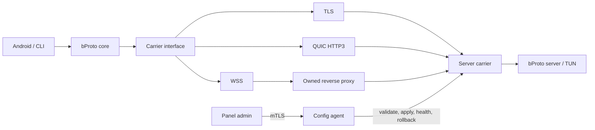

# План завершения bProto 2.5.0

Дата: 17 ноября 2026. База: ветка test/connection-lab, коммит 2f7296d.
Статус: разработка не завершена; этот документ не является отчётом о готовом релизе.

## Цель и границы

Сохранить аутентификацию, шифрование и wire-format bProto. Добавить и проверить
TLS, HTTP/3 и WSS как внешние транспорты, управление конфигурациями и Android.
Отдельно исследовать ECH и воспроизводимые ClientHello-профили. Ни конкретный SNI,
ни HTTP/3, ни совпадение JA3/JA4 сами по себе не доказывают устойчивость к РКН.

Исходный план уточняется технически:
- Действительный сертификат используется только с соответствующим ключом и правом
  на домен. «Подмена цепочки через fallback» не заменяет владение ключом.
- HTTP/3 требует HTTP/3 framing. Произвольный QUIC-stream не объявляется h3.
- TLS 1.3 не имеет renegotiation; padding не возникает автоматически до кратности 16.
- Domain fronting допускается только при подтверждённой поддержке провайдера.
  Работающий WSS reverse-proxy с одинаковыми SNI/Host — отдельный режим.
- ECH скрывает inner ClientHello, но не адрес назначения. Он не делает закрытый IP доступным.
- p > 0.05 в KS-тесте не доказывает равенство распределений. Публикуются также
  размер выборки, эффект, доверительный интервал и условия эксперимента.
- Отсутствие открытого маркера проверяется для содержимого, а не условием
  «ни один байт не совпал»: отдельные байты неизбежно совпадают случайно.

## Текущее состояние

| Компонент | Реализовано | Подтверждено | Остаётся |
|---|---|---|---|
| Native bProto | UDP, crypto, replay, TUN/NAT | Native тесты и отдельный Docker TUN-стенд | Повторить TUN через новые транспорты |
| TLS | Python-мост, Android-мост | Сертификат, native handshake, неверный PSK | Нагрузка, shutdown, device e2e |
| HTTP/3 | Python aioquic, QUIC v1, Retry | 7 тестов, 80% покрытия; native handshake | Native/Android реализация, независимый клиент, TUN e2e |
| WSS | Python и Android OkHttp | Native handshake; локальный JVM TLS/WSS UDP-обмен | Device e2e и реальный reverse-proxy |
| Android | TLS/WSS, импорт, защита сокета | 24 JVM-теста, сборка APK | QUIC, instrumentation, Wi-Fi/mobile transitions |
| Панель/агент | Экспорт; TLS apply, health, rollback; mTLS | Тесты доступа, mTLS и транзакций; 75% покрытия агента | Полный deploy e2e, схемы всех транспортов, crash recovery |
| ClientHello-профили | Только старые enum-настройки | Browser matching не подтверждён | Библиотека, профили, эталоны, тесты |
| ECH | Нет | Нет | Backend, DNS HTTPS RR, ключи, политика fallback |
| Белые списки/CDN | WSS-путь для своего домена | Локальный WSS, не живой CDN | Разрешённый управляемый узел и целевая сеть |
| Релиз | CI сборок и тестов | Предыдущие сборки успешны | Финальный SHA, артефакты, release gate |

Исторические тесты не переносятся автоматически на новый SHA.
Старый docs/PLAN.md — исторический MVP-план; утверждения об эмуляторе в нём
не доказывают проверку новых TLS/WSS/QUIC-транспортов.

## Архитектура

Для native/Android QUIC предпочтителен Rust с существующими JNI/FFI и quinn.
HTTP/3 добавляется совместимой библиотекой поверх quinn; собственный TLS/QUIC
стек не пишется. Выбор библиотеки завершается прототипом и проверкой лицензии,
Android-совместимости, TLS-проверки и владения сокетами.

## Порядок реализации и критерии

### A. Общий интерфейс транспорта и Android QUIC

Зависимости: существующие native handshake-тесты и Python HTTP/3-сервер.
1. Вынести connect/send/receive/close/diagnostics и endpoint в интерфейс carrier.
2. Реализовать HTTP/3 POST /bproto, length-prefixed DATA, проверку сертификата
   и токена, совместимые с Python-сервером.
3. Передать внешний UDP fd в Android для protect до первого пакета.
   Защита loopback fd не считается защитой QUIC-сокета.
4. Ограничить очереди, таймауты и память; закрывать фоновые задачи при отказах.
5. Импортировать один явно выбранный transport; неизвестные варианты отклонять.

Готово: Rust↔Python двусторонние IP-пакеты через TUN, wrong-token/certificate/PSK,
потери и разрыв связи; сборки трёх ABI; Android instrumentation с protect,
revoke, stop/start и сменой сети. Выбор QUIC в панели экспортирует рабочий профиль.

### B. Профили ClientHello

1. Выбрать TLS-backend с проверяемой поддержкой профилей на целевых платформах.
2. Снять разрешённые локальные эталоны конкретных версий Chrome/Firefox/Safari:
   ОС, браузер, дата, ALPN, JA3/JA4, hash pcap.
3. Ввести versioned profiles с проверкой схемы и совместимости backend.
   Случайный выбор выполняется один раз на сессию, а не на каждый пакет.
4. Сравнить реально отправленный handshake, расширения/GREASE и поведение ошибок.
5. Не принимать неподдерживаемый профиль молча; возвращать понятную ошибку.

Готово: все заявленные профили воспроизводимы, есть отрицательный тест отличия,
обновление профилей без пересборки в пределах возможностей backend.
Совпадение fingerprint описывается как наблюдение, а не гарантия DPI-неразличимости.

### C. ECH и управляемый reverse-proxy

1. Поднять собственный TLS/ECH endpoint и HTTPS DNS RR в локальном стенде.
2. Реализовать загрузку/проверку ECHConfig, ограничение TTL и обновление ключей.
3. Добавить режимы required/optional/disabled. В required отказ завершает сессию;
   в optional раскрытие обычного SNI показывается в диагностике.
4. Проверить WSS через реальный reverse-proxy с проверкой origin TLS, сохранением
   пути/Authorization, отключённым кешем и известными idle limits.
5. Провайдерские интеграции оформлять отдельными проверенными конфигурациями.
   Не добавлять заранее чужие банковские/государственные домены в «готовый whitelist».

Готово локально: ECH успешен, отсутствует, просрочен, повреждён, ключ ротирован;
WSS проходит через proxy, неверный origin-сертификат отвергается.
Готово в целевой сети: оператор предоставил разрешённый endpoint и измерения.
Внешние проверки не препятствуют реализации локального кода, но остаются release gate.

### D. Fallback и ограничение ресурсов

1. Единая политика обычных HTTP-ответов, malformed requests, неверного токена,
   повторов и превышения лимитов; никаких произвольных proxy destinations.
2. Backpressure и лимиты: входящие соединения, stream count, буферы, timeout,
   размеры HTTP-заголовков, очереди UDP, частота запросов агента.
3. Проверить TCP/UDP loss, slow clients, закрытие во время handshake и rebind.
4. Снять трафик собственных и тестовых запросов; описать различимые признаки.

Готово: ограниченное потребление ресурсов под нагрузкой, отсутствие открытого
payload-маркера на внешнем интерфейсе, проверяемое поведение active probes.
Не обещать, что любой сторонний DPI не обнаружит протокол.

### E. Завершение config-agent и панели

1. Versioned JSON Schema для TLS/HTTP3/WSS, server-side валидация и dry-run.
2. Штатные validator/health команды, systemd unit, права пользователя и каталогов.
3. Межпроцессная блокировка, journal транзакции и восстановление после kill/power loss.
4. Apply/health/rollback для выбранного сервиса; ревизия конфига предотвращает
   перезапись параллельным администратором. Идемпотентный request ID.
5. mTLS-ротация, ограничение клиентских идентичностей, аудит без секретов.
6. Панель различает validation_failed, rolled_back, rollback_failed и applied.

Готово: реальная панель → mTLS-агент → процесс сервиса → туннель; негативные тесты
сертификатов, конфигов, crash recovery, concurrent apply и failed rollback.
Mocked systemctl-тест не считается таким e2e.

### F. Android и сетевой стенд

1. Установить emulator/system image либо использовать тестовый телефон.
   JVM-тесты не заменяют VpnService instrumentation.
2. Проверить TLS/HTTP3/WSS: DNS, IPv4, запрет утечек IPv6, исключения маршрутов,
   блокировку прямого выхода при отказе, смену Wi-Fi/mobile и отмену подключения.
3. Namespace/container firewall разрешает только адрес собственного тестового proxy;
   прямой сервер запрещён. Positive: через proxy работает; negative: напрямую нет.
4. Отдельно проверить публичный endpoint с Android и реальным Интернетом.
5. Сохранять команды, seed, SHA, pcaps с синтетическим payload и результаты.

Готово: повторяемый сценарий Android → carrier → bProto → внешний тестовый сервис.
Если отсутствует KVM, проверить программную эмуляцию; это ограничение скорости,
не доказательство невозможности теста.

### G. CI, безопасность и выпуск

1. Зафиксировать зависимости и проверить их уязвимости/лицензии.
2. CI: Rust, Python, TypeScript, Android, integration, instrumentation,
   coverage и smoke развёртывания.
3. Покрытие нового модуля >=70%; дополнительно обязательны негативные сценарии.
4. Измерить handshake latency, throughput, CPU/RAM и восстановление при потерях
   на фиксированной конфигурации; публиковать методику и сырые результаты.
5. RU/EN: развёртывание, обновление, откат, конфиг, диагностика, ограничения.
6. После прохождения обязательных gate: версии 2.5.0, changelog, подписанный tag,
   сборки, SHA256SUMS, состав зависимостей. Android signing key хранится как CI secret.
   Без постоянного signing key артефакт явно называется debug/test build.

Готово: каждый опубликованный артефакт соответствует одному проверенному SHA;
CI зелёный именно для него; обновление с 2.0 проверено, включая сохранение профилей.

## Доказательства готовности

Для каждого пункта хранить: SHA, команду, окружение, ожидаемый результат,
фактический результат, ссылку на CI/artifact и ограничения.
Статусы: не начато / реализовано / локально проверено / внешне проверено / блокировано.
«Блокировано» всегда сопровождается конкретной зависимостью, а не общим «нет времени».

| Release gate | Обязательные доказательства |
|---|---|
| Все транспорты | Native и Android e2e, negative auth/cert, teardown |
| QUIC/H3 | Независимый HTTP/3 клиент и разбор capture |
| Профили | Версионированные реальные browser captures и negative comparison |
| ECH | Успешный handshake, required fallback failure, key rotation |
| Агент | Real process apply/reload/rollback/crash recovery |
| Белые списки | Изолированный deny-by-default стенд и отдельно целевая сеть |
| Ресурсы | Нагрузка, потери, bounded memory и очереди |
| Поставка | CI final SHA, установщик, update/rollback, checksums, signing status |

## Зависимости и оценка

Порядок: A → F; B и C имеют исследовательский риск; D сопровождает все транспорты;
E можно выполнять независимо; G собирает доказательства по мере выполнения.
Не обещать дату полного релиза до прототипов A/B/C и доступного Android-стенда.
После них оценить объём по реально выбранным библиотекам и результатам испытаний.

Внешние данные: домен/сертификат/право настройки CDN, доступ к целевой сети,
Android-устройство или emulator, signing key для release APK.
Отсутствие домена не блокирует Rust/Kotlin-разработку и локальные тесты.

## Честные ограничения

100% гарантии обхода РКН нет. Правила сетей и CDN меняются.
Профили и конфигурации требуют обновления; небезопасный fallback не включается молча.
Локальный стенд доказывает только проверенный сценарий. Версия 2.5.0 не должна
публиковаться как «весь исходный план готов», пока перечисленные gate не закрыты.
Сокращение объёма релиза требует явного изменения требований, а не переименования
незавершённого этапа в готовую функцию.
