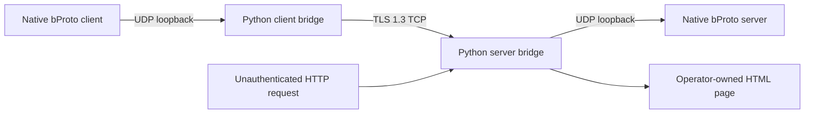

# Experimental TLS carrier / Экспериментальный TLS-транспорт

## Архитектура / Architecture

bProto keeps its handshake, authentication and encryption. A separate TLS carrier
frames datagrams with a two-byte length inside TLS Application Data. The bridge
authenticates with an independent random bearer token; it never replaces bProto's
PSK. One client bridge process serves one native client. One authenticated server
connection gets one upstream UDP socket. TLS authentication validates the hostname
and certificate chain; there is no insecure verification switch.

bProto сохраняет собственный протокол. Мост переносит его UDP-пакеты через
настоящий TLS 1.3. Для CLI это отдельный экспериментальный процесс; Android 10+ использует встроенный мост.
Не используйте его для полного туннеля без отдельного маршрута к реальному TCP
адресу сервера: клиент bProto видит только loopback и не закрепит внешний адрес.

## Настройка / Configuration

Requirements: Python 3.11+, OpenSSL with TLS 1.3. No pip dependencies.
In panel Settings, use the TLS configuration editor to download
`tls-server.json` and `tls-client.json`. Configure your own certificate hostname,
server address, TCP port, certificate/key paths, HTML page and random token.
An optional client CA path supports local test certificates. Empty means system trust.

В Settings панели доступны домен, адрес, TCP-порт, пути сертификата и ключа,
HTML-страница, доверенный CA клиента и генератор токена. Экспорт не развёртывает
конфигурацию. Файлы содержат секрет; установите права 600. Сертификаты выпускает
оператор для принадлежащего ему домена. Пример домена: vpn.example.com
(это пример, не разрешённый узел РКН).

1. Run native bProto server on UDP 127.0.0.1:4443.
2. Create an operator-owned HTML file at the configured fallback path.
3. Start server carrier:
   `python3 tools/tls-bridge/bridge.py server tls-server.json`.
4. Start client carrier:
   `python3 tools/tls-bridge/bridge.py client tls-client.json`.
5. Set native client endpoint to 127.0.0.1:14443, keeping native user/PSK/tag keys.
6. Test connection before enabling any full-tunnel routes.

Server config uses `listen_host`, `listen_port`, `hostname`, `token`,
`cert`, `key`, `fallback_file`, `upstream_host`, `upstream_port`.
Client config uses `server_host`, `server_port`, `hostname`, `token`,
`local_port`, optional `ca`. Ports/upstream can also be edited in JSON.
Restart the bridge after configuration or certificate changes; no rebuild needed.
Connections are interrupted by restart. No automatic reconnect is implemented.

## Проверки / Validation

`python3 -m unittest discover -s tests -p test_tls_bridge.py -v`

Tests generate a temporary localhost certificate and verify TLS 1.3 negotiation,
framed UDP round trips, a local HTML response to HTTP probing, hostname rejection
and oversized-frame rejection. These are carrier tests, not a real RKN/DPI test,
Android test, or full native bProto-over-TLS end-to-end test.
Inspect captures with Wireshark for TLS records and handshake validity.
A matching JA3/JA4 alone cannot prove indistinguishability from a browser.

## Статус требований / Requirements checklist

- [x] Real TLS 1.3, certificate and hostname validation.
- [x] Existing protocol bytes carried inside encrypted TLS records.
- [x] Local owned HTML response to unauthenticated HTTP requests.
- [x] Panel configuration export; restart without rebuilding.
- [x] Experimental Android TLS carrier and protection of its TCP socket.
- [ ] Android device/runtime validation.
- [ ] QUIC v1 / HTTP3 carrier, Retry, HTTP3 fallback.
- [ ] Browser ClientHello profiles, JA3/JA4 and timing verification.
- [ ] Supported CDN reverse proxy / WebSocket / HTTP2 CONNECT integration.
- [ ] ECH and region-specific allowlist validation.
- [ ] Real DPI, packet-loss, latency and overhead measurements.
- [ ] Production admission limits, metrics and service supervision.

## Честные ограничения / Honest limitations

No 100% blocking resistance. OpenSSL's ClientHello is not Chrome/Firefox/Safari.
The HTTP/1.1 CONNECT exchange is a private carrier convention, not a general
HTTP proxy or a browser-equivalent application flow. Do not announce h2/h3 without
implementing those protocols. Malformed/slow requests may close; this does not
guarantee identical behavior for all active probes. TLS 1.3 has no renegotiation.
A local HTML page does not borrow another site's certificate or TLS session.

SNI does not bypass an IP allowlist. ECH does not make a blocked IP reachable.
Domain fronting requires provider support and operator-controlled infrastructure;
no third-party domains are automatically used. TCP introduces head-of-line blocking.
The carrier is an experimental lab component, not a finished censorship bypass.

## Android integration update

Android 10+ now includes an experimental in-process carrier. In panel Settings,
provide an existing native bProto import key and export an Android TLS key.
Import its text into the app. The TCP socket is protected through VpnService
before connecting; TLS hostname validation and system CA trust are mandatory.
A carrier failure stops the native tunnel. No silent downgrade to UDP occurs.
Android 8/9 retain native UDP support but reject TLS carrier profiles.

This supersedes the earlier statement that Android integration is absent.
Android build/unit verification is separate from device runtime validation:
instrumentation and device end-to-end tests remain outstanding.
See [Russian instructions](README.ru.md).
